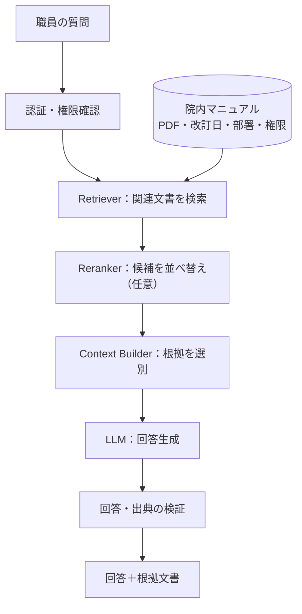
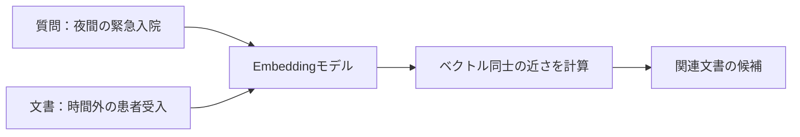
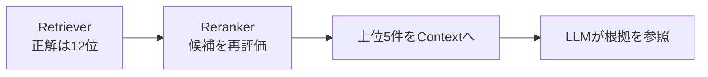

OpenAI APIを呼び出し、LangChainでRAGを組み立てる。今ではAIコーディングエージェントの助けを借りれば、こうしたアプリケーションは比較的短時間で作れます。

では、実際に運用してみて**「回答精度が期待ほど出ない」**と言われたら、どこから直すべきでしょうか？

プロンプトを変更する？ Temperatureを下げる？ Retrieverを変える？ Rerankerを追加する？

この記事では、**病院の院内マニュアル検索AIを導入する架空案件**を通して、LLM・RAGの仕組みと、問題の切り分け方を学びます。図解、ミニクイズ、実務上の判断例を交えながら、技術用語を「実際に使う道具」として理解することが目標です。

:::message
この記事の病院・マニュアル・障害ログ・評価値はすべて説明用の架空例です。臨床判断をAIに委ねる設計を推奨するものではありません。
:::

## 1. まずはシステム全体を見てみよう

病院から、こんな相談を受けたとします。

> 「院内マニュアルが多すぎて、職員が必要な手順を探すのに時間がかかります。質問するだけで、根拠付きで教えてくれるAIを作れませんか？」

例えば「夜間に緊急入院があった場合、誰に連絡すればいいですか？」という質問です。

このようなシステムでは、LLMに質問を送る**前**にも、いくつかの処理が必要です。



この構成は**RAG（Retrieval-Augmented Generation：検索拡張生成）**の一例です。LLMが学習済みの知識だけで答えるのではなく、外部の文書を検索し、その内容を入力に加えて回答します。

ここで覚えたいのは、**LLMはシステムの一部分でしかない**ということ。間違った回答が出ても、LLMが悪いとは限りません。

### ミニクイズ①：まず疑うべきは？

「最新版のマニュアルはデータベースにあるのに、検索結果の上位20件に一度も出てきません」

どこを調べるべきでしょう？

- A. Temperatureを下げる
- B. Retrieverと検索用データを調べる
- C. 回答の文章を短くする

:::details 答えと理由
**B。** 正しい文書が検索段階で見つかっていません。LLMに届いていない情報を、生成設定だけで補うことはできません。索引への登録、Chunkの切り方、検索方式、フィルタ、Top-kなどを確認します。
:::

## 2. BM25とEmbedding：検索の「ものさし」が違う

検索には大きく分けて、**文字列の一致を利用する方法**と、**意味的な近さを利用する方法**があります。

| 検索したい質問 | 文書の表現 | 考えたい検索方式 |
|---|---|---|
| 「夜間の緊急入院」 | 「夜間の緊急入院時の連絡先」 | キーワード検索 |
| 「夜間の緊急入院」 | 「時間外の患者受入手順」 | ベクトル検索 |
| 「規程 ABC-123」 | 「規程 ABC-123 第4版」 | キーワード検索 |
| 「薬剤の保管ルール」 | 「医薬品管理に関する規定」 | ベクトル検索 |

※ 実際の検索順位を計算した表ではなく、各方式が得意になりやすいケースの模式例です。

### BM25：単語の一致と希少性を見る

BM25は、検索語が文書に現れる頻度、文書集合での珍しさ、文書の長さなどを使って順位を付ける代表的な手法です。

```text
質問：「夜間 緊急入院」
文書A：「夜間の緊急入院時は当直医へ連絡」 → 語がよく一致
文書B：「時間外の患者受入の手順」         → 表現が異なる
```

BM25では、一般に**珍しい識別子や専門用語が一致すること**が有力な手掛かりになります。ただし、単語の一致だけで業務上の正しさが分かるわけではありません。

### Embedding：文章をベクトルにする

Embeddingは文章などを数値ベクトルに変換した表現です。質問と文書を同じモデルでベクトル化し、コサイン類似度などを使って近いものを探します。



コサイン類似度は次の式で表されます。

$$
\mathrm{sim}(a,b)=\frac{a\cdot b}{\|a\|\|b\|}
$$

これは**ベクトルの向きの近さ**を測る指標です。実際のEmbeddingは高次元であり、「意味が近い」ことと「事実が正しい」ことは同じではありません。否定、数字、製品番号などを取り違えることもあります。

### Hybrid Search：両方の強みを利用する

BM25とベクトル検索を併用し、検索結果を統合する方法を**Hybrid Search**と呼びます。例えばRRF（Reciprocal Rank Fusion）は、異なる検索器のスコアを直接足す代わりに、**順位**を利用して統合します。

$$
\mathrm{RRF}(d)=\sum_{r\in R}\frac{1}{k+\mathrm{rank}_r(d)}
$$

実務では「Hybrid Searchにすれば必ず良い」ではなく、評価質問に対してBM25単独・ベクトル単独・Hybridを比較します。

### ミニクイズ②：文書番号を間違える

「規程 ABC-123」を検索したいのに、意味が似た「規程 ABC-132」が頻繁に上位に来ます。まず比較すべきものは？

- A. 厳密な識別子を扱えるキーワード検索
- B. Temperatureの変更
- C. LLMの回答文字数

:::details 答えと理由
**A。** 型番・文書番号のような文字列は厳密一致が重要です。BM25や識別子の完全一致フィルタを検討します。意味検索だけに頼らない設計が有効な場合があります。
:::

## 3. Vector DB、Retriever、Rerankerは何が違う？

これらは同じ「検索周りの道具」でも役割が違います。

| 用語 | 役割 | 例 |
|---|---|---|
| **Chunk** | 文書を検索しやすい単位に分割したもの | PDFの節・段落 |
| **Embedding** | 文章を数値ベクトルに変換する | 質問と文書のベクトル |
| **Vector DB** | ベクトルを保存・検索する | pgvector、Qdrant |
| **Retriever** | 質問に関連する候補を取得する | 上位20件を検索 |
| **Reranker** | 候補を再評価して並べ替える | 20件から上位5件を選ぶ |
| **Metadata** | 文書に付随する属性 | 部署、版、更新日、権限 |

### Rerankerが役立つ瞬間

例えば、Retrieverが20件を返し、正しいマニュアルが**12位**にあったとします。しかしLLMには上位5件しか渡せません。



Rerankerは、質問と候補文書をより詳しく照合し、順位を改善するための仕組みです。代表的な**Cross-Encoder**では、質問と文書をまとめてモデルに入力して関連性を評価します。独立にEmbeddingを作るBi-Encoder型検索と比べ、相互関係を詳しく評価できる一方、候補ごとの計算が増えることがあります。

ただし、**Retrieverが取得していない文書を、Rerankerが突然見つけることはできません。**

### Metadataは「検索の正しさ」を守る

院内規程には、例えば次のような属性を持たせられます。

```json
{
  "document_id": "manual_104",
  "department": "nursing",
  "version": "3.2",
  "effective_date": "2026-10-01",
  "status": "active",
  "access_role": ["nurse", "admin"]
}
```

最新版だけを検索する、有効な規程に限定する、閲覧権限のない文書を除外する、といった処理ができます。なお、**アクセス権限はサーバー側で強制**する必要があり、プロンプトだけに任せてはいけません。

## 4. 実務シミュレーション：精度が出ない！どこを直す？

ここがこの記事の中心です。病院に導入したRAGで、次のトラブルが起きたとします。**先に対応を考えてから答えを開いてみてください。**

### CASE 1：正解文書が検索されない

**現場の報告：** 評価質問100件のうち24件で、正解文書が検索上位20件に入りません。

**ログ：** 正解文書は登録されています。質問と文書では表現が異なります。

- A. Temperatureを0にする
- B. Embedding・BM25・Chunkingを検証する
- C. Rerankerだけを高性能化する

:::details 診断結果・改善アクション
**B：Retrieval failure（検索失敗）。** 正解が候補にないため、Rerankerでは救えません。まずRecall@20を測り、BM25・ベクトル検索・Hybrid Search・Chunk分割を同じ評価セットで比較します。
:::

### CASE 2：検索できたのに、LLMが使わない

**現場の報告：** 正解文書は検索結果の12位。LLMに渡すのは上位5件のみ。

**ログ：** Retrieverの候補20件には正解がありますが、Contextにはありません。

- A. RerankerとContext選別を検証する
- B. Temperatureを高くする
- C. Fine-tuningする

:::details 診断結果・改善アクション
**A：Ranking / Context selection failure。** 検索には成功しています。Reranker導入や文書選別方法を検討し、正解文書が最終Contextに入る割合、順位、遅延、費用を比較します。
:::

### CASE 3：正しい根拠があるのに、手順を付け足す

**現場の報告：** マニュアルにはない確認手順をAIが回答に追加します。

**ログ：** 正解文書はLLMに渡されています。

- A. 検索件数を無条件に増やす
- B. Vector DBの容量を増やす
- C. 生成時の指示・根拠整合性・モデルを検証する

:::details 診断結果・改善アクション
**C：Generation / Grounding failure。** 実際に渡したContextと回答を照合します。根拠にない断定を控える指示、構造化出力、出力検証、モデル比較などを検討します。Temperatureを下げるだけでは根本対策になりません。
:::

### CASE 4：古いマニュアルで回答する

**現場の報告：** 文書の内容には忠実ですが、昨年度の規程を引用しています。

**ログ：** 新旧両方の版が検索対象です。

- A. モデルのパラメータ数を増やす
- B. Metadataと版管理を修正する
- C. Temperatureを下げる

:::details 診断結果・改善アクション
**B：Data freshness / Versioning failure。** 「根拠に忠実」と「現行手順として正しい」は別です。有効期間、版、状態、更新フローを管理し、検索段階で適切な版に絞ります。
:::

### CASE 5：正しいけれど遅すぎる

**現場の報告：** 正答率は目標達成。ただしp95応答時間は12秒で、目標は5秒。

**ログ：** 検索0.2秒、Reranker 6.5秒、LLM生成4.8秒など。

- A. Retrieverの検索件数を増やす
- B. 正答率だけを測り直す
- C. Rerankerの候補数と処理方式を検証する

:::details 診断結果・改善アクション
**C：Latency bottleneck。** Rerankerが大きな遅延要因です。候補数、モデル、バッチ処理などを比較します。ただし高速化と同時に検索・回答品質も測定します。
:::

:::message
実際の障害では複数の原因が重なることがあります。これらは「最初にどこを疑うか」を学ぶための演習です。改善策を本番に反映する前に、評価データで比較する必要があります。
:::

## 5. LLMの生成原理：Temperatureは何を変える？

一般的な自己回帰型LLMは、それまでのToken列に基づき、次のTokenの確率分布を計算します。

$$
P(x_t\mid x_1,\ldots,x_{t-1})
$$

Tokenは単語と同じとは限らず、単語の一部や記号なども含みます。

**Temperature**は、この次Tokenの確率分布の鋭さを調整します。

$$
P_i(T)=\frac{\exp(z_i/T)}{\sum_j\exp(z_j/T)}
$$

ここで \(z_i\) は確率に変換する前のスコア（Logit）です。

下表は架空のLogit \([2,1,0]\) から計算した模式例です。

| Temperature | 候補A | 候補B | 候補C |
|---|---:|---:|---:|
| 0.5 | 86.7% | 11.7% | 1.6% |
| 1.0 | 66.5% | 24.5% | 9.0% |
| 2.0 | 50.6% | 30.7% | 18.6% |

低いほど高スコア候補に集中し、高いほど他の候補も選ばれやすくなります。

### ミニクイズ③：Temperatureを下げれば正確になる？

- A. はい。Temperatureを0にすれば誤答はなくなる
- B. いいえ。誤った候補が最高スコアなら、その誤りが安定する場合もある

:::details 答えと理由
**B。** Temperatureは候補の選ばれ方を変える設定であり、根拠の正しさを保証する機構ではありません。推論基盤によっては低Temperatureでも完全な再現性は保証されません。
:::

### TransformerとAttentionも最低限知っておこう

TransformerのSelf-Attentionは、入力文脈内のToken間の情報を組み合わせるための仕組みです。

$$
\mathrm{Attention}(Q,K,V)=\mathrm{softmax}\left(\frac{QK^\top}{\sqrt{d_k}}\right)V
$$

Q（Query）、K（Key）、V（Value）は学習済みの重みを使って計算される表現です。Attentionによって文脈に応じた情報の集約ができますが、**Attentionの重みそのものを人間に理解可能な「判断理由」とみなすことはできません。**

実務では、Context Windowの制限、長文中の情報の取りこぼし、入力Token増加による遅延や費用などを考える際に、この基礎理解が役立ちます。

## 6. 「精度が上がった」をどう証明する？

改善の前後で、**同じ評価セット**を使って測定します。

検索品質を測る代表的な指標は次のとおりです。

$$
\mathrm{Recall@k}=\frac{\text{上位k件で取得した関連文書数}}{\text{全関連文書数}}
$$

$$
\mathrm{Precision@k}=\frac{\text{上位k件で取得した関連文書数}}{k}
$$

例えば、関連文書が全部で5件、検索上位5件のうち関連文書が3件なら、Recall@5もPrecision@5も60%です。この例では偶然同じ値ですが、通常は異なり得ます。

### ミニクイズ④：検索数を増やせば精度は上がる？

上位5件から20件へ増やすと、正解文書が含まれやすくなる可能性があります。では、回答品質も必ず上がるでしょうか？

- A. 必ず上がる
- B. 必ず下がる
- C. 上がるとは限らず、評価が必要

:::details 答えと理由
**C。** 正解文書の取りこぼしが減っても、無関係な文書が増えたり、Contextが長くなったりして、生成品質・費用・遅延が悪化することがあります。
:::

さらに、最終回答の品質は検索とは分けて測定します。

| 指標 | 何を確かめる？ |
|---|---|
| Answer Correctness | 回答は事実として正しいか |
| Faithfulness / Groundedness | 回答が提示した根拠に支えられているか |
| Citation Accuracy | 引用先が主張を裏付けているか |
| Abstention | 情報不足のとき適切に回答を控えられるか |
| Task Success Rate | 業務上の目的を達成できたか |
| p95 Latency | リクエストの約95%がどの時間以内に完了したか |

**根拠に忠実でも、その根拠が古ければ正しい回答とは限りません。** だから検索品質、回答品質、データの鮮度を分けて考えます。

## 7. RAG、Fine-tuning、Tool Callingをどう選ぶ？

顧客から「弊社専用AIに社内データを学習させたい」と言われたとします。

ここでの「学習」は曖昧です。何を実現したいのかによって、選ぶ道具が変わります。

| 方法 | 主に変えるもの | 向いている課題 |
|---|---|---|
| Prompt Engineering | モデルへの指示 | 回答形式・ルールの調整 |
| RAG | 推論時に参照する情報 | 更新される社内文書の参照 |
| Fine-tuning | モデルの重み | 特定タスクや出力パターンへの適応 |
| Tool Calling | 外部システムとの連携 | DB参照・計算・業務操作 |

### ミニクイズ⑤：毎週変わる社内規程

規程が毎週更新され、職員は常に最新版を参照する必要があります。最初に検討するのは？

- A. 毎週モデルをFine-tuningする
- B. 更新・版管理のできるRAGを設計する
- C. Temperatureを0にする

:::details 答えと理由
**B。** 最新文書を必要なときに検索する設計が適しています。なお、在庫数や口座残高など厳密な最新値を扱うなら、RAGではなく業務DBへのAPI問い合わせが適する場合もあります。
:::

## 8. Python自作RAGからLangChainへ：いつ移行する？

**LangChainはLLMそのものではありません。** LLM、Retriever、外部ツールなどを共通のインターフェースで組み合わせるためのフレームワークです。

OpenAI APIを直接呼び出すなら、例えば次のように書けます。

```python
from openai import OpenAI

client = OpenAI()
response = client.responses.create(
    model="gpt-4.1-mini",
    input="RAGとは何ですか？"
)
print(response.output_text)
```

LangChainでは、例えば次のようになります。

```python
from langchain_openai import ChatOpenAI

model = ChatOpenAI(model="gpt-4.1-mini")
response = model.invoke("RAGとは何ですか？")
print(response.content)
```

この程度ならLangChainのメリットは小さいでしょう。

| 状況 | まず検討する構成 |
|---|---|
| 単純なチャット・固定的なRAG | Python＋各種SDK |
| 複数のLLM・検索基盤を共通化 | LangChainも候補 |
| 複雑な状態管理・中断再開・承認 | LangGraphなども候補 |
| 実行トレース・評価・監視 | LangSmithなどの観測基盤 |

**サービスのユーザー数やコード行数だけでLangChainの必要性は決まりません。** 重要なのは、接続コードの重複、変更頻度、保守負担を本当に減らせるかです。

### LangGraphとLangSmithは？

- **LangGraph**：複数ステップの状態、分岐、途中再開、人間の承認などを扱う仕組み
- **LangSmith**：実行トレース、評価、デバッグ、監視などに使うプラットフォーム

単純な分岐ならPythonの`if`文で十分です。フレームワークを使うこと自体を目的にしない方がよいでしょう。

## 9. 顧客との要件定義：精度95%とは何か？

顧客：「AIの回答精度は95%以上にしてください」

ここで「できます」と即答する前に、**何の精度か**を確認します。

> エンジニア：「95%というのは、正しい文書を見つけられる割合でしょうか。それとも最終回答の正確性でしょうか。まず実際の質問を集め、評価方法を一緒に決めたいです」

顧客：「最終的な回答が正確であってほしいです」

> エンジニア：「では回答の正確性を主要指標にします。あわせて、答えが見つからない場合に推測で断定しないこと、重要な業務で重大な誤答を出さないことも別に評価しましょう」

架空のPoCであれば、次のように**測定可能な受入条件**を合意することが考えられます。

| 項目 | 仮の評価条件 |
|---|---|
| 評価質問 | 200件 |
| 正解文書のHit@5 | 95%以上 |
| 最終回答の正確性 | 90%以上 |
| 根拠のない重大な断定 | 0件を目標 |
| p95応答時間 | 8秒以内 |
| 評価方法 | 人手判定＋自動評価 |

※ 数値は説明用の仮目標であり、医療現場に必要な安全基準ではありません。実運用の基準は用途・リスク・責任分界に応じて定めます。

また、**PoC（技術的な実現可能性の検証）**、**MVP（最小限の製品による価値検証）**、**Production（継続的な本番運用）**は別です。デモが動くだけでは、認証、監視、障害対応、データ更新、運用体制まで整ったことにはなりません。

## 10. 最後の実務演習：改善計画を説明できる？

あなたは病院向けRAGの担当エンジニアです。

**評価ログ**
- Hit@5：78%
- Hit@20：96%
- 最終回答の正確性：82%
- p95応答時間：9秒
- 目標：Hit@5 95%、回答正確性90%、p95 8秒

この結果から、まず何を調べますか？

:::details 考え方の一例
Hit@20は高いのにHit@5が低いため、**候補には正解が含まれているが、上位に来ていない**可能性があります。まず検索順位とContextへの採用率を調べ、Rerankerなどを比較します。

ただし、回答正確性82%の原因が順位だけとは限りません。正しいContextが渡った質問に絞って、生成段階の失敗も別途評価します。

p95が目標超過なので、Reranker追加でさらに遅くならないか、各段階の処理時間と費用を同時に測定します。

顧客には「検索上位の改善が有力な仮説だが、正答率と速度を同時に検証してから採用する」と説明します。
:::

## おわりに：APIを使えることと、設計できることは違う

AIエンジニアが、すべてのアルゴリズムを一から実装する必要はありません。OpenAI APIやLangChainなどの抽象化を使うことは、むしろ合理的です。

ただし、**回答が間違ったときに、どこで情報が失われたのかを追えること**、**改善したときに、その効果を評価できること**、**技術選定の理由を顧客の業務要件と結び付けて説明できること**は重要です。

AIコーディングエージェントによって、コードを書くことのハードルは下がっています。だからこそ、「何を作るか」「どう設計するか」「何を測るか」「どこを直すか」を判断する力を磨きたいと思います。

### 参考資料

- [OpenAI API Documentation](https://platform.openai.com/docs/overview)
- [LangChain / LangGraph / LangSmith Documentation](https://docs.langchain.com/)
- [Retrieval-Augmented Generation for Knowledge-Intensive NLP Tasks (Lewis et al., 2020)](https://arxiv.org/abs/2005.11401)
- [Attention Is All You Need (Vaswani et al., 2017)](https://arxiv.org/abs/1706.03762)
