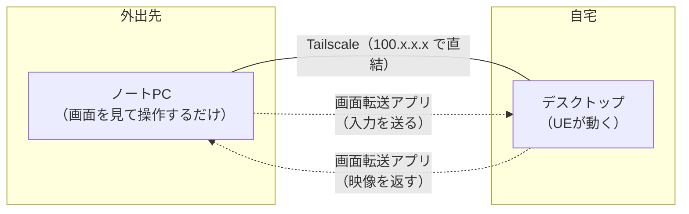

## はじめに

Unreal Engine（以下UE）でゲームを作っていると、ノートPCではどうにもならない場面が出てきます。エディタを開いただけでファンが全開になり、ライティングをビルドすればバッテリーがみるみる減っていく。

結局、重い作業は家のデスクトップでやることになります。でも、そのためだけに早めに帰ったり、外での予定を切り上げたりするのは、正直もったいないですよね。

だったら、家のデスクトップを外から操作できるようにしてしまえばいい。ノートPCは画面を映してキーボードとマウスを送るだけで、UEが動いているのは家のマシンです。カフェで作業していても、ノートPCのファンは静かなままです。

<!-- TODO: カフェでノートPCからUEのビューポートを動かしている写真かGIFをここに -->

組んでみると思ったより簡単で、ポート開放もルーターの設定もいりませんでした。しかも設定のほとんどはターミナルのコマンドで済みます。システム設定の画面を何階層もたどる必要がないので、手順をそのままコピペすれば再現できますし、あとから見直すのも楽です。

### この記事でやること

1. **ネットワーク**: 外出先のノートPCから家のデスクトップに届く経路を作る（Tailscale）
2. **デスクトップの準備**: スリープ対策とSSHの有効化（`pmset`、`caffeinate` など）
3. **画面転送**: デスクトップの画面を低遅延でノートPCに送る（macOSの画面共有、Parsec、Moonlight/Sunshine）
4. **UE側の調整**: リモート操作でもカクつかないようにする
5. **仕上げ**: 出かける前と接続を、それぞれ1コマンドにまとめる

## 全体像



Tailscaleは、2台を同じプライベートネットワークに置く役割です。画面を送る処理は別のアプリが担当します。この2つを分けて考えると、トラブルが起きたときにどちらの問題かを切り分けやすくなります。

## 組み合わせ別のおすすめ

| ノートPC → デスクトップ | おすすめ | 備考 |
|---|---|---|
| Mac → Mac（両方Apple silicon） | macOS標準の画面共有（高性能モード） | 追加費用なし。60fps、仮想ディスプレイ対応 |
| Mac → Mac（Intel Macを含む） | Parsec | 標準の画面共有は高性能モードが使えない |
| Windows → Mac | Parsec | |
| Mac / Windows → Windows（GPU搭載） | Parsec または Moonlight + Sunshine | UEを本格的に使うならこの組み合わせが一番快適 |

Windowsのリモートデスクトップ（RDP）も使えますが、UEではおすすめしません。UEのエディタには、リモートセッションに接続しているとビューポートのリアルタイム描画を既定でオフにする設定（`bDisableRealtimeViewportsInRemoteSessions`）があり、RDPで開くとビューポートが止まったように見えます。ファイル整理など軽い作業用と割り切るのがよいと思います。

以下、コマンドの例では自宅のデスクトップの名前を `my-desktop` とします。

## Step 1: Tailscaleで2台をつなぐ

### デスクトップ側（Mac）

Mac用のTailscaleにはApp Store版などのアプリ版と、Homebrewで入るコマンドライン版（オープンソースの `tailscaled`）があります。デスクトップ側はコマンドライン版がおすすめです。システムのデーモンとして動くので、再起動したあとログインしていなくてもTailscaleにつながります。

```bash
brew install tailscale
sudo brew services start tailscale
sudo tailscale up
```

`tailscale up` で表示されたURLをブラウザで開いてログインすれば完了です。

:::message
アプリ版とコマンドライン版は同時に使えません。すでにアプリ版を入れている場合は、どちらかに統一してください。
:::

### デスクトップ側（Windows）

管理者権限のPowerShellで実行します。

```powershell
winget install -e --id Tailscale.Tailscale
tailscale up
```

### ノートPC側

ノートPCは普段使いなので、メニューバーから切り替えられるアプリ版で十分です。

```bash
# Mac
brew install --cask tailscale
```

```powershell
# Windows
winget install -e --id Tailscale.Tailscale
```

両方に**同じアカウント**でログインすると、各端末に `100.x.y.z` 形式のIPが割り当てられます。管理画面でMagicDNSを有効にしておけば、IPの代わりに端末名で接続できます。

### つながったか確認する

ここからはノートPCのターミナルで確認します。

```bash
tailscale status          # デスクトップがオンラインか
tailscale ping my-desktop # 疎通と経路
tailscale netcheck        # 今いるネットワークの状態
```

`tailscale ping` の結果に `via DERP` と出る場合は、Tailscaleの中継サーバーを経由しています。中継だと遅延が増え、画面転送の体感が悪くなります。`via 192.168...` や `via <グローバルIP>:<ポート>` のように直接つながっていれば理想的です。

`tailscale netcheck` では、今いるネットワークでUDPが通るかや、一番近い中継サーバーまでの遅延がわかります。カフェや大学で遅いと感じたら、まずこれを見ると原因の見当がつきます。

<!-- TODO: 家のWi-Fi / カフェ / テザリング / 大学 で tailscale ping の結果を並べたスクショか表 -->

:::message
大学や会社のネットワークは、UDPが制限されていて直結できず、中継経由になることがあります。その場合はスマホのテザリングなど別の回線で試すと、原因がネットワーク側かどうか切り分けられます。
:::

個人利用であれば、Tailscaleの無料のPersonalプランで足ります。ただしPersonalプランは非商用向けとされているので、仕事で使う場合は有料プランを検討してください。

## Step 2: デスクトップ側の準備

画面転送アプリを入れる前に、デスクトップ側を遠隔操作に耐える状態にしておきます。ここを忘れると、外出先で接続できないことに気づいても手の打ちようがありません。

### スリープと停電の設定（Mac）

`pmset` で電源まわりをまとめて設定できます。

```bash
sudo pmset -a sleep 0          # システムをスリープさせない
sudo pmset -a displaysleep 10  # ディスプレイは10分で消してOK
sudo pmset -a womp 1           # ネットワークアクセスでスリープ解除
sudo pmset -a autorestart 1    # 停電から復旧したら自動で起動

pmset -g                       # 設定を確認
```

ずっとスリープなしにしたくない場合は、`sleep 0` を飛ばして、後で紹介する `caffeinate` を使います。

### スリープの設定（Windows）

管理者権限のPowerShellで実行します。

```powershell
powercfg /change standby-timeout-ac 0   # 電源接続時はスリープしない
powercfg /change monitor-timeout-ac 10  # ディスプレイは10分で消す
```

停電から復旧したときに自動で起動させるには、BIOS/UEFIの「Restore on AC Power Loss」をオンにします。ここだけはターミナルからは設定できません。

### SSHを有効にする（Mac）

外から `caffeinate` を実行したり、状態を確認したりするためにSSHを有効にします。

```bash
sudo systemsetup -setremotelogin on
sudo systemsetup -getremotelogin   # Remote Login: On なら成功
```

:::message
`Turning Remote Login on or off requires Full Disk Access privileges` と表示された場合は、ターミナルにフルディスクアクセスを許可する必要があります。システム設定 > プライバシーとセキュリティ > フルディスクアクセス でターミナルを追加してください。ここは画面での操作が1回だけ必要です。
:::

ノートPC側からは、公開鍵を登録しておくとパスワードなしで入れるようになります。

```bash
ssh-copy-id my-desktop
ssh my-desktop 'hostname'   # デスクトップの名前が返ってくればOK
```

### caffeinate で必要なときだけ起こしておく

出かけない日までずっとスリープなしにしておくのは、ちょっと気が引けます。外で作業する日だけ起きていてくれれば十分ですよね。

そんなときはmacOS標準の `caffeinate` コマンドが便利です。実行している間だけMacがスリープしなくなり、止めれば元の設定に戻ります。

```bash
# 出かける前に実行。Ctrl+Cで止めるまでスリープしない
caffeinate -dis
```

| オプション | 効果 |
|---|---|
| `-d` | ディスプレイをスリープさせない |
| `-i` | 操作がないときのスリープを防ぐ |
| `-s` | システムのスリープを防ぐ（電源につながっているときのみ有効） |
| `-t 秒数` | 指定した秒数が経ったら解除する |
| `-w PID` | 指定したプロセスが終わるまで起きておく |

時間を決めておきたいなら `-t` が使えます。

```bash
# 8時間だけ起こしておく
caffeinate -dis -t 28800
```

UEでライティングのビルドやパッケージングなど時間のかかる処理を回すときは、`-w` を使うとエディタが終わるまでスリープを防げます。

```bash
caffeinate -is -w $(pgrep -n UnrealEditor)
```

出かけたあとで `caffeinate` を忘れていたことに気づいても、さっき有効にしたSSHで外から実行できます。

```bash
ssh my-desktop 'nohup caffeinate -dis -t 28800 >/dev/null 2>&1 &'
```

ただし、Macがすでにスリープしていると接続できません。上の `pmset -a womp 1` を設定しておきましょう。

### モニターをつながない場合（ヘッドレス運用）

- **Windows（GPU搭載）**: モニターがつながっていないとGPUが画面を出力せず、ParsecやSunshineで真っ黒な画面になることがあります。ダミーのHDMIプラグ（数百円〜千円程度）をGPUに挿しておくと確実です。
- **Mac**: macOS標準の画面共有の高性能モードなら仮想ディスプレイが使えるので、モニターなしでも動きます。

## Step 3: 画面転送アプリを設定する

### A. Mac → Mac: macOS標準の画面共有（高性能モード）

両方がApple siliconのMacで、macOS Sonoma 14以降なら、標準の画面共有に高性能モードがあります。60fps、ステレオ音声、仮想ディスプレイ（1〜2枚）に対応していて、追加のアプリなしでかなり快適に使えます。

**デスクトップ側**: 画面共有をオンにします。SSHで外からでも実行できます。

```bash
sudo launchctl enable system/com.apple.screensharing
sudo launchctl load -w /System/Library/LaunchDaemons/com.apple.screensharing.plist

# 5900番ポートで待ち受けていれば成功
sudo lsof -nP -iTCP:5900 -sTCP:LISTEN
```

**ノートPC側**: 接続も1行です。

```bash
open vnc://my-desktop
```

画面共有アプリが開いたら、画面共有のタイプで「高性能」を、ディスプレイのタイプで仮想ディスプレイの枚数を選びます。2回目以降は前回の設定で接続されます。

<!-- TODO: 高性能モードでUEを開いているスクショ（仮想ディスプレイ2枚の様子だとわかりやすい） -->

仮想ディスプレイを2枚にすると、片方をUEのビューポート、もう片方をブラウザやエディタに使えて便利です。

:::message
高性能モードはUDPの5900〜5902番ポートで通信します。Tailscaleのアクセス制御（ACL）を初期設定から変えていなければ問題ありません。また帯域が必要で、4Kディスプレイ1枚あたり75Mbps程度が推奨されています。
:::

### B. Parsec（Mac / Windowsどちらのホストでも使える）

Parsecはゲーム配信向けに作られた低遅延のリモートデスクトップで、macOSとWindowsの両方をホストにできます。

インストールはコマンドで済みます。

```bash
# Mac
brew install --cask parsec
```

```powershell
# Windows
winget install -e --id Parsec.Parsec
```

両方で同じアカウントにログインし、デスクトップ側で Settings > Host の Hosting Enabled を有効にすれば、ノートPCの一覧にデスクトップが出てきます。

macOSをホストにする場合、画面収録やアクセシビリティの権限はmacOSの仕様上、画面で許可するしかありません。初回だけ「Setup」ボタンから案内に沿って許可してください。

:::message
仮想ディスプレイや4:4:4カラー（文字のにじみが減る）は有料のParsec Warpの機能です。コードやUEの細かいUIを長時間見るなら、4:4:4は効きます（ホストがWindowsの場合）。
:::

### C. Moonlight + Sunshine（Windowsホスト向け）

オープンソースの組み合わせです。デスクトップにSunshine（ホスト）、ノートPCにMoonlight（クライアント）を入れます。GPUのハードウェアエンコーダーを使うので、遅延が小さく画質も良好です。そして、ペアリングから接続までコマンドラインで完結します。

**デスクトップ側（Windows）**

```powershell
winget install -e --id LizardByte.Sunshine
```

インストール後、ブラウザで `https://localhost:47990` を開いてユーザー名とパスワードを設定します。

**ノートPC側**

```bash
brew install --cask moonlight
alias moonlight="/Applications/Moonlight.app/Contents/MacOS/Moonlight"
```

**ペアリング**

ノートPC側で、PINを決めてペアリングを始めます。

```bash
moonlight pair my-desktop --pin 1234
```

待機している間に、デスクトップ側でSunshineのAPIに同じPINを送ります。

```powershell
curl.exe -k -u ユーザー名:パスワード -X POST https://localhost:47990/api/pin -d '{\"pin\":\"1234\",\"name\":\"macbook\"}'
```

**接続**

```bash
moonlight list my-desktop            # ストリーミングできるアプリ一覧
moonlight stream my-desktop Desktop  # デスクトップ全体を表示
```

:::message alert
SunshineのmacOS版は実験的な扱いです。Macをホストにする場合は、AかBを選ぶほうが無難です。
:::

## Step 4: リモートでUEを快適に使うための設定

### エディタがバックグラウンドで遅くならないようにする

UEはエディタのウィンドウが非アクティブになると、CPU使用を抑えてフレームレートを落とします。リモート操作中はこれがカクつきの原因になることがあります。

エディタの環境設定にある「バックグラウンド時にCPU使用を抑える（Use Less CPU when in Background）」をオフにすれば直りますが、これも設定ファイルに1行足すだけで済みます。**エディタを閉じた状態で**、プロジェクトのフォルダで実行してください。

```bash
INI="Saved/Config/MacEditor/EditorPerProjectUserSettings.ini"   # Windowsは WindowsEditor
grep -q bThrottleCPUWhenNotForeground "$INI" 2>/dev/null || \
  printf '\n[/Script/UnrealEd.EditorPerProjectUserSettings]\nbThrottleCPUWhenNotForeground=False\n' >> "$INI"
```

すでに設定がある場合は追記しないようにしています。次にエディタを開いたとき、環境設定でオフになっていれば反映されています。

### ビットレートを上げすぎない

ParsecやMoonlightのビットレートを最大にすると、回線が追いつかずにかえってカクつきます。外出先では20〜30Mbps程度から始め、様子を見て上げるのがおすすめです。Moonlightなら起動時に指定できます。

```bash
moonlight stream my-desktop Desktop --bitrate 25000 --fps 60
```

### プロジェクトファイルはデスクトップに置く

UEのプロジェクトはデスクトップ側に置き、ノートPCには置かないようにします。ノートPCはあくまで画面と入力の窓口です。ちょっとしたファイルの受け渡しは、Tailscaleの端末間ファイル転送（Taildrop）が便利です。

```bash
tailscale file cp ./texture.png my-desktop:   # ノートPCから送る
tailscale file get ~/Downloads                # デスクトップ側で受け取る
```

## 仕上げ: 出かける前と接続を1コマンドにする

ここまでのコマンドを、ノートPCの `~/.zshrc` に関数としてまとめておきます。

```bash
# 自宅デスクトップを8時間起こしておいて、画面共有で接続する
ue() {
  tailscale ping -c 1 my-desktop >/dev/null || { echo "my-desktop に届きません"; return 1; }
  ssh my-desktop 'nohup caffeinate -dis -t 28800 >/dev/null 2>&1 &'
  open vnc://my-desktop
}
```

カフェに着いたら、ターミナルで `ue` と打つだけです。デスクトップに届くかを確認し、スリープを防ぎ、画面共有を開くところまで一度に済みます。

<!-- TODO: ue コマンドを打ってから接続されるまでの様子（GIF） -->

## よくあるトラブル

| 症状 | 確認するコマンド・ポイント |
|---|---|
| 接続できない | `tailscale status` でデスクトップがオンラインか。`ssh my-desktop pmset -g` でスリープ設定を確認 |
| つながるが遅い、カクつく | `tailscale ping my-desktop` で `via DERP` になっていないか。`tailscale netcheck` でUDPが通っているか |
| 画面共有がつながらない | `ssh my-desktop sudo lsof -nP -iTCP:5900 -sTCP:LISTEN` で待ち受けているか |
| 画面が真っ黒 | Windowsの場合、モニターかダミープラグがGPUにつながっているか |
| Macで操作が効かない | ホストアプリに画面収録・アクセシビリティの権限を付与したか |
| Moonlightで接続できない | `moonlight list my-desktop` でアプリ一覧が返るか。WindowsのファイアウォールでSunshineが許可されているか |

## まとめ

- ネットワークはTailscale、画面転送は別アプリ、と役割を分けて考える
- Apple silicon同士ならmacOS標準の画面共有（高性能モード）で十分。OSが混在するならParsec、WindowsのGPU機ならMoonlight + Sunshine
- 設定はほとんどターミナルで済む。`pmset`、`caffeinate`、`launchctl`、`tailscale` あたりを覚えておくと、外からでも直せる
- 最後に関数にまとめておけば、接続は `ue` の一言

ノートPCは軽くて静かなまま、UEの重い処理は家のデスクトップに任せられるようになります。

## 参考

- [Tailscale ダウンロード](https://tailscale.com/download)
- [Apple: 高性能な画面共有を使用する](https://support.apple.com/guide/remote-desktop/apdf8e09f5a9/mac)
- [Parsec: Install Parsec app on macOS](https://support.parsec.app/hc/en-us/articles/4423549357837-Install-Parsec-app-on-macOS)
- [Parsec: Feature Matrix](https://support.parsec.app/hc/en-us/articles/4407194154253-Feature-Matrix)
- [Sunshine ドキュメント](https://docs.lizardbyte.dev/projects/sunshine)
- [Moonlight PC](https://github.com/moonlight-stream/moonlight-qt)
- [Unreal Engine: UEditorPerformanceSettings](https://dev.epicgames.com/documentation/unreal-engine/API/Editor/UnrealEd/UEditorPerformanceSettings)
