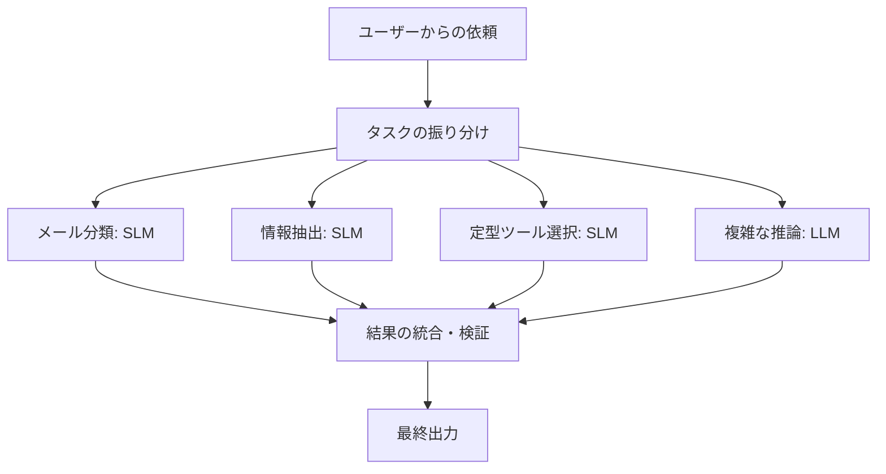

「大は小を兼ねる」ということわざがあります。

大きなものは小さなものの代わりにもなる。確かにその通りです。

では、AIの世界でもそうでしょうか？

ChatGPTをはじめとする大規模言語モデル（LLM）は、文章作成からプログラミング、数学、研究支援まで、さまざまなタスクをこなせるようになりました。

でも、ちょっと想像してみてください。

**世界トップクラスの頭脳を持つ博士に、毎日ひたすらメールの仕分けをお願いするとしたら？**

もちろん博士は仕事をこなしてくれるでしょう。でも、仕事の内容に対して、ちょっと贅沢すぎませんか？

実はAI開発でも、似たようなことが起こります。複雑な推論や高度な知識が必要ないタスクにまで、巨大なモデルを使っているケースがあるのです。

そこで登場するのが、**SLM（Small Language Model：小規模言語モデル）**です。

今回は、SLMとは何なのか、そして実際の開発現場でLLMより優れた選択肢になり得るのはどんな場面なのか、具体例を交えて考えてみます。

## 1. そもそもSLMって何？

SLMは、その名の通り、小規模な言語モデルです。

LLMと同じように文章を理解したり生成したりできますが、一般にモデルの規模が小さく、少ない計算資源で動かしやすいという特徴があります。

その規模を表す指標のひとつが、**パラメータ数**です。

パラメータとは、AIが学習によって獲得した数値のこと。ものすごく大ざっぱに言うと、AIが情報を処理するための調整可能なつまみの数だと思ってください。

例えば、こんなモデルがあります。

| モデル | パラメータ数 | 開発元 |
|---|---:|---|
| Gemma 3 270M | 約2.7億 | Google |
| Qwen3-0.6B | 約6億 | Alibaba |
| Phi-4-mini | 約38億 | Microsoft |
| Qwen3-4B | 約40億 | Alibaba |

:::message
SLMに「何B以下」という厳密で統一された定義はありません。また、パラメータ数だけで性能が決まるわけではなく、学習データの質、モデル構造、学習方法も重要です。
:::

それでも、小さいモデルには明確な利点があります。

**持ち運びやすい。動かしやすい。特定の仕事に集中させやすい。**

では、具体的に何がうれしいのでしょうか？

## 2. SLMがLLMに勝てるかもしれない5つの場面

### ① 仕事が単純で、大きな頭脳が必要ないとき

例えば、カスタマーサポートの問い合わせを分類するシステムを考えてみましょう。

ユーザーから、こんなメッセージが届きます。

> 昨日注文した商品がまだ届かないのですが、配送状況を確認できますか？

AIにお願いしたい仕事は、文章を読んで、適切なカテゴリーに分類することだけ。

```json
{
  "category": "shipping",
  "priority": "normal"
}
```

これだけです。

ここで必要なのは、哲学的な思考でも、大学院レベルの数学でもありません。決められたカテゴリーの中から適切なものを選ぶ能力です。

こうした範囲の狭いタスクなら、SLMでも十分な精度を出せる可能性があります。さらに、実際の問い合わせデータを使ってファインチューニング（追加学習）すれば、その業務に特化したモデルにできます。

一般常識を幅広く知っている博士よりも、社内業務を熟知した専門スタッフの方が、特定の仕事では頼りになる。そんなイメージです。

ただし、単純な分類なら従来の機械学習やルールベースでも十分な場合があります。SLMを導入すること自体を目的にしないのが大切です。

### ② とにかく大量に、何度も呼び出すとき

次は、1日に10万件の問い合わせを処理するシステムを想像してください。

1回だけAIを呼び出すなら、多少コストが高くても気にならないかもしれません。でも、10万回となると話は別です。

仮に次のような条件だったとします。

- モデルA：1回の処理コストが0.01円
- モデルB：1回の処理コストが0.1円
- 処理件数：1日10万件

すると、1日あたりのコストは1,000円と10,000円。年間では36.5万円と365万円です。

※金額は説明用の仮定で、特定のモデルやAPIの実際の料金ではありません。

同じ業務を十分な精度でこなせるなら、少しのコスト差が大きな経済的メリットになります。

もちろん、SLMが必ず安いとは限りません。GPUを自前で用意する場合、モデルの稼働率やサーバー費用も効いてきます。

それでも、大量・反復処理において、モデルの小ささは非常に魅力的です。

**1回の賢さだけでなく、10万回働いてもらうための経済性が重要になるわけです。**

### ③ インターネットに接続できないとき

SLMの面白いところは、スマートフォンやPCなどの端末上で動作させられる可能性があることです。これを**オンデバイスAI**と呼びます。

例えば、工場の設備点検アシスタント。現場では通信環境が不安定かもしれません。

あるいは、病院内の情報処理システム。患者情報を外部サービスへ送信することが難しいケースもあるでしょう。

そんなとき、端末内で推論できれば、クラウドへの通信を必要としない構成にできます。

GoogleはGemma 3 270Mについて、ファインチューニングや量子化を活用してブラウザ上で動かす例を紹介しています。

もちろん、すべてのSLMがどんなスマホでも快適に動くわけではありません。使用可能なメモリやCPU、GPU、推論エンジンなどの条件次第です。また、ローカル実行だけで情報セキュリティが保証されるわけでもありません。

それでも、クラウド接続を前提としない設計ができるのは、大きな強みです。

### ④ 応答速度が重要なとき

ロボットにこんな指示を出す場面を想像してみましょう。

> 赤い箱を見つけたら、棚の右側に運んで。

AIが指示を理解してから次の動作を決めるまで、毎回数秒かかっていたらどうでしょうか。ロボットはそのたびに考え込むことになります。

もちろん、安全性が重要なリアルタイム制御を言語モデルだけに任せるべきではありません。でも、高レベルなタスクの解釈や、次に実行する操作の選択では、応答速度が重要です。

小さなモデルは一般に計算量やメモリ使用量を抑えやすく、条件によっては応答時間も短縮できます。

例えば「移動する」「停止する」「対象物を確認する」といった限られた指示の分類に、毎回巨大なLLMを呼ぶ必要があるでしょうか？

このような場面では、必要な機能に特化したSLMが候補になります。

### ⑤ 自分たちの仕事に特化させたいとき

これは個人的に、SLMのかなり面白いポイントだと思います。

巨大な汎用モデルをゼロから学習するのは、個人や小規模チームには非常に難しい仕事です。一方、公開されているSLMをベースに、特定の仕事に適応させるのは、ずっと現実的な選択肢です。

例えば、医薬品名の表記ゆれを候補として抽出するモデル、社内用語を適切なカテゴリーに分類するモデル、定型文から業務システム用のJSONを生成するモデルなど。

必要なデータを用意し、LoRAなどの手法で追加学習させれば、比較的少ない計算資源で専門化を試せます。

ただし、ファインチューニングすれば必ず大規模モデルを上回るわけではありません。

狙うべきは「何でもできるAI」ではなく、**「この業務なら安定してこなせるAI」**です。

## 3. 実際にどんなSLMがあるの？

ここで具体的なモデルを3つ紹介します。

### Gemma 3 270M：小ささを活かした専門家

Googleが公開した約2.7億パラメータのモデルです。特徴は、特定タスクへのファインチューニングと軽量な配備を重視した設計であること。

Googleは、文章を絵文字に変換する専用モデルを作り、ブラウザ内で実行するチュートリアルも公開しています。

面白いのは、何でも答える汎用チャットAIを作ろうとしていないこと。仕事を絞り込むことで、とても小さなモデルにも役割を与えています。

### Phi-4-mini：小さくても推論を諦めない

Microsoftが公開した約38億パラメータのモデルです。推論、数学、コーディング、関数呼び出しなどを重視して開発されました。

「パラメータが少ない＝単純な仕事しかできない」というわけではないことを示す一例です。学習データの品質や訓練方法を工夫することで、モデルサイズに対して高い性能を狙えます。

### Qwen3シリーズ：用途に合わせてサイズを選ぶ

AlibabaのQwen3シリーズには、0.6B、1.7B、4B、8Bなど、さまざまなサイズが用意されています。

ここが面白いところです。最初からひとつの巨大モデルだけを選ぶのではなく、タスクの難易度や環境に合わせてモデルサイズを比較できます。

例えば、0.6Bで難しい仕事が4Bなら実用的にこなせる、といった場面も考えられます。逆に、4Bでも難しい場合はもっと大きなモデルを使う。

大切なのは「一番大きなモデルを使う」ことではなく、**必要な品質を満たす最小限のモデルを見つけること**です。

## 4. 実はAIエージェントと相性がいい？

最近のAIは、質問に答えるだけでなく、ツールを操作したり、複数の手順を実行したりするようになってきました。いわゆるAIエージェントです。

例えば、毎朝の業務レポートを作成するAIエージェントを考えてみます。

1. 新着メールを確認する
2. 内容を分類する
3. 必要な情報を抽出する
4. 売上データを取得する
5. レポートを作成する

この5つの仕事、全部に最先端の巨大LLMが必要でしょうか？ おそらく、そうではありません。

メールの分類や決められた項目の抽出はSLMに任せ、複数の情報を統合した複雑な分析だけLLMに任せる。こうした役割分担が考えられます。



これは、優秀な社員ひとりに全業務を担当してもらうのではなく、得意分野に応じて仕事を分担する組織に似ています。

実際、2025年に公開された論文『Small Language Models are the Future of Agentic AI』でも、AIエージェントが繰り返し実行する特化したタスクにSLMを活用する考え方が提唱されています。

また、Googleが公開したFunctionGemmaは、自然言語からアプリ操作などの関数呼び出しを生成することに特化した小規模モデルです。

同モデルの公開評価では、モバイル操作タスクへのファインチューニングによって、正解率が58%から85%に向上したと報告されています。ただし、これは特定条件下の結果であり、他のLLMより一般的に優れることを示すものではありません。

それでも、**AIに何をさせるかが明確なら、モデルもその仕事に合わせて作る**という方向性は、かなり興味深いと思います。

## 5. でも、本当にSLMの方が優秀なの？

ここまでSLMの利点を紹介してきましたが、もちろん万能ではありません。

例えば、複雑な数学的推論、長文の横断的理解、専門知識を組み合わせた問題解決、未知の状況への対応など。こうしたタスクでは、大規模なモデルの方が高い性能を示すケースが多くあります。

また、小さいモデルは単純なタスクですら誤ることがあります。特にAIエージェントでは、この誤りが積み重なる点に注意が必要です。

例えば、ひとつのステップを90%の確率で正しく実行できるAIがあるとしましょう。

各ステップの成功が独立していると仮定すると、10ステップすべてに成功する確率は、

$$
0.9^{10} \approx 34.9\%
$$

になります。

1回の正解率は悪くなさそうでも、何度も判断を重ねると全体の成功率は大きく下がる可能性があるのです。

つまり、軽量だからといって、何でもSLMに任せるのは危険です。失敗による再実行のコストも考えなければなりません。

では、どうすればいいのでしょうか？

## 6. 開発現場で考えたい「SLMファースト」という設計

個人的におすすめしたいのは、まず仕事を分解することです。

例えば、新しくAIアプリを開発するときには、次の順番で考えます。

**Step 1：そもそも言語モデルが必要？**

ルールベースや通常の機械学習で解決できるなら、それが最も合理的な場合もあります。

**Step 2：必要な精度を決める**

単なる候補提示なのか、間違えると重大な問題になる処理なのか。要求水準を明確にします。

**Step 3：小さなモデルから試す**

SLMで実用的な品質が得られるかを確認します。

**Step 4：品質が不足する場合は改善する**

プロンプト、出力形式の制約、検索による情報補完、ファインチューニングなどを試します。

**Step 5：難しいケースだけLLMに任せる**

SLMで扱えるケースと、大きなモデルが必要なケースを分けます。

ここで測定したいのは、単なるベンチマークスコアだけではありません。

| 評価項目 | 確認したいこと |
|---|---|
| タスク成功率 | 実際の仕事を正しく完了できるか |
| 応答時間 | 利用者が待たされないか |
| 処理コスト | 一定件数の処理にいくらかかるか |
| 運用負荷 | 配備や更新を維持できるか |
| 安定性 | 想定外の入力や環境で破綻しないか |

特に大切なのは、**1回の呼び出しコストではなく、1件の仕事を正しく完了するためのコスト**だと思います。

いくら呼び出し単価が安くても、何度もやり直すなら、結局は高くつくかもしれません。これはSLMに限らず、AIシステム全般で重要な視点です。

## 7. まとめ：小は大を兼ねる、こともある。

SLMの魅力は、ただ小さいことではありません。

小さいからこそ、身近なデバイスで動かしたり、大量のタスクを処理したり、特定の業務に適応させたりしやすいことです。

一方で、大規模モデルにしか任せにくい仕事も確かに存在します。だから、SLMとLLMを対立させる必要はないと思います。

むしろ、これからのAI開発では、

**「どれだけ賢いモデルを使うか」だけでなく、「どの仕事に、どれくらいの知能が必要なのか」**

を考えることが重要になっていくのではないでしょうか。

大きなモデルが得意な仕事は大きなモデルに。小さなモデルで十分な仕事は、小さなモデルに。

ときには、小さな専門家の方が、巨大な万能選手よりも合理的な選択になります。

**大は小を兼ねる。でも、適材適所なら小も大を兼ねる。**

そんなAI開発が、これからもっと広がっていくのかもしれません。

---

## 参考資料

- [Small Language Models are the Future of Agentic AI (arXiv)](https://arxiv.org/abs/2506.02153)
- [Google: Introducing Gemma 3 270M](https://developers.googleblog.com/en/introducing-gemma-3-270m/)
- [Google: Fine-tune Gemma 3 270M for on-device](https://developers.googleblog.com/ja/own-your-ai-fine-tune-gemma-3-270m-for-on-device/)
- [Google DeepMind: FunctionGemma](https://deepmind.google/models/gemma/functiongemma/)
- [Microsoft: Phi-4-mini-instruct](https://ai.azure.com/catalog/models/Phi-4-mini-instruct)
- [Qwen Team: Qwen3](https://qwenlm.github.io/blog/qwen3/)

※モデル仕様や配備条件は更新される可能性があります。実運用では最新のモデルカード、ライセンス、利用環境をご確認ください。

<!-- 追加企画案：架空の問い合わせ100件をSLMとLLMに分類させ、正解率・処理時間・完了コストを比較する。未実施のため本文には結果を記載しない。 -->
